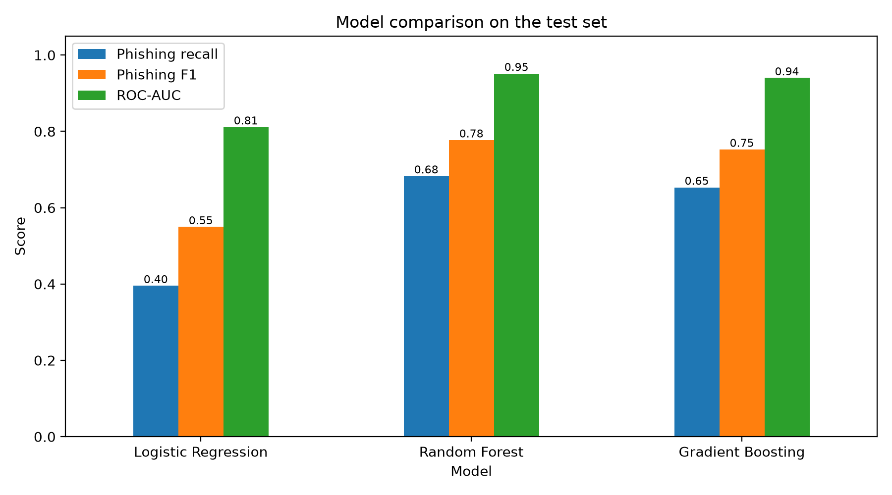
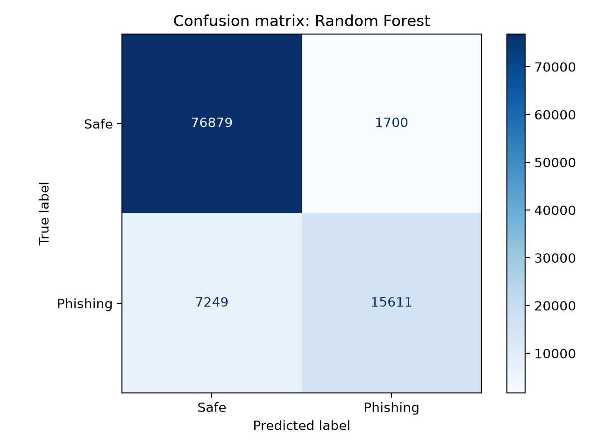
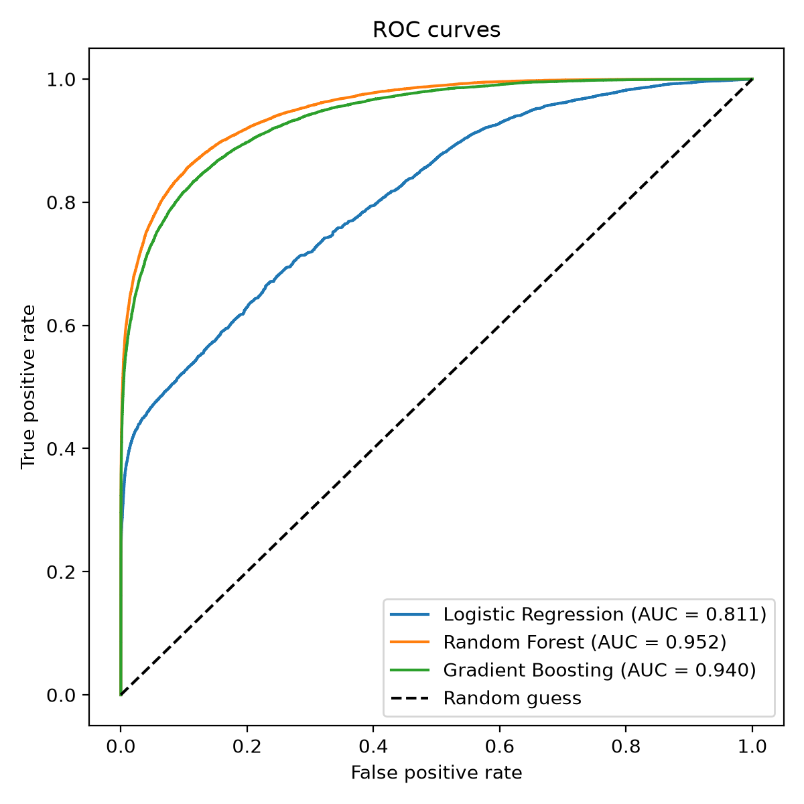
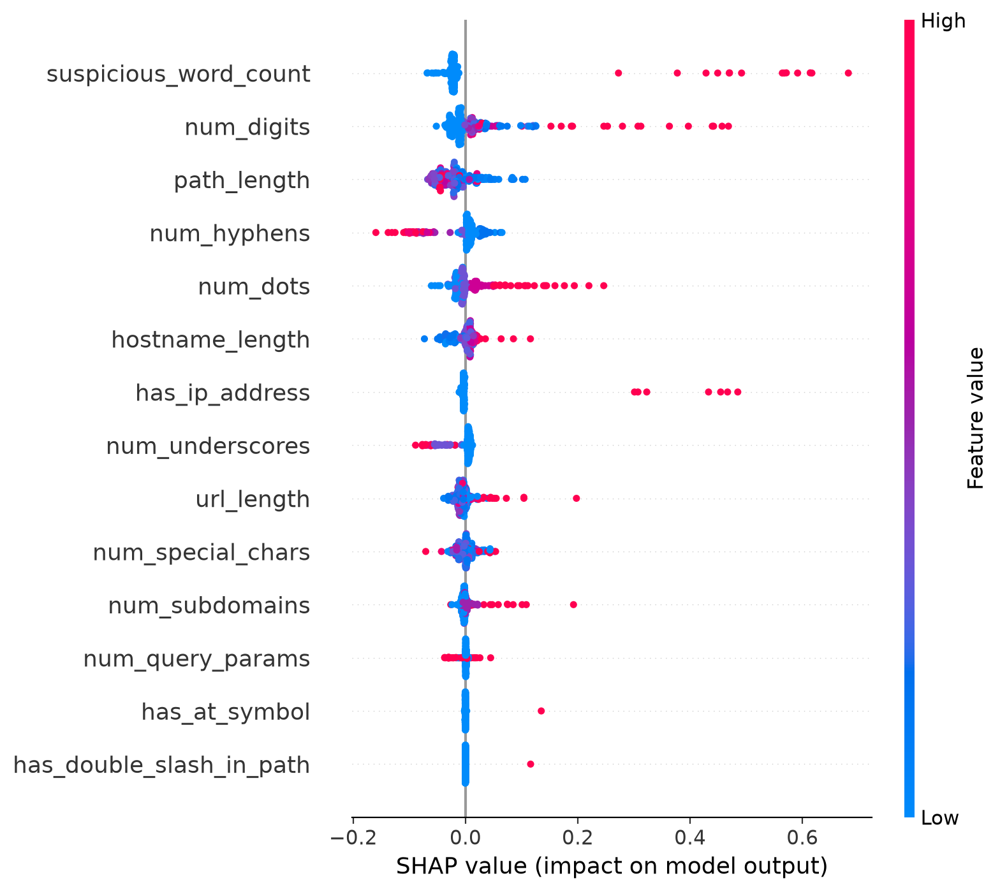

# Phishing URL Detector

A machine learning app that classifies a URL as **Phishing** or **Safe**.

Student: Hasan Ratul (20243120073)
Course: Professional Training 2, Yunnan University

## Overview
The system extracts 14 lexical features from a raw URL (length, number of dots,
hyphens, digits, "@" symbol, IP address as host, suspicious keywords, etc.)
and classifies it with machine learning models. Three models are compared:
Logistic Regression, Random Forest, and Gradient Boosting. The best one by
ROC-AUC (Random Forest) is used in the Gradio app, which also explains each
prediction with SHAP values and red flags.

## Dataset
"Phishing Site URLs" from Kaggle (549,346 URLs labelled good/bad).
After removing duplicate URLs, 507,195 unique URLs remain
(392,897 safe, 114,298 phishing). The dataset is not included in this
repository because of its size. Download it from Kaggle and save it as
`data/urls.csv`.

## Dataset bias and how it was handled
Early versions classified clean URLs such as `https://www.wikipedia.org` as
phishing with over 90% confidence. Two shortcuts were found in the data:
- Almost no URL in the dataset has a scheme (http/https): 0.09% of phishing
  and 0% of safe URLs. The scheme is now removed before feature extraction.
- URLs without any path are 97.5% phishing (2,420 of 2,483), so the model
  learned "no path means phishing". To fix this, each training URL that has a
  path also gets a domain-only copy with the same label (training only; the
  test set is untouched). In the final model 403,801 copies were added to the
  405,756 original training rows.
After these changes, `wikipedia.org` and `github.com` are classified as Safe
and fake domains such as `paypa1-secure-login.xyz` are still flagged.

## Hugging Face
- Trained model and model card: https://huggingface.co/Ratul16961/phishing-url-random-forest
- Project page: https://huggingface.co/spaces/Ratul16961/phishing-url-detector

The app uses a local model from `models/` if it exists. Otherwise it downloads
the trained model from the Hugging Face Hub, so it also runs without
training. The model was trained with scikit-learn 1.9.1, numpy 2.5.4 and
pandas 3.1.0; use similar versions if you load it. A live Gradio Space needs
a paid Hugging Face plan, so the Gradio app is run locally with `python app.py`.

## Quick start (no training needed)
    cd has073
    python3 -m venv .venv
    source .venv/bin/activate
    pip install -r requirements.txt
    python app.py

The first start downloads the trained model (about 176 MB) from the Hugging
Face Hub. The dependency versions in `requirements.txt` are the ones the model
was trained and tested with.

## Tests
    pip install -r requirements-dev.txt
    python -m pytest

The unit tests cover the URL normalisation, every feature and a few odd inputs.

## Docker (optional)
    docker build -t phishing-url-detector .
    docker run --rm -p 7860:7860 phishing-url-detector

## Figures

## Setup
    python3 -m venv .venv
    source .venv/bin/activate
    pip install -r requirements.txt
    mkdir -p data models

## Usage
    python train.py          
    python evaluate.py       
    python shap_plot.py     
    python manual_test.py    
    python app.py           

## Project structure
- features.py: URL normalisation and feature extraction
- train.py: training, augmentation, evaluation, saves the best model
- evaluate.py: charts (comparison, confusion matrix, ROC, feature importance)
- shap_plot.py: SHAP summary plot
- before_experiment.py: Random Forest without augmentation (for comparison)
- manual_test.py: manual sanity tests on safe and phishing URLs
- app.py: Gradio web interface
- requirements.txt: dependencies
- tests/: unit tests (pytest)
- requirements-dev.txt: test dependencies
- Dockerfile: container build for the app
- LICENSE: MIT license

## Models
- **Logistic Regression** (baseline): a linear model. It standardises the 14
  features and outputs a phishing probability with a sigmoid of a weighted sum.
- **Random Forest** (used in the app): an ensemble of 100 decision trees. Each
  tree is trained on a bootstrap sample of the training URLs and considers a
  random subset of features at every split (minimum 5 samples per leaf). The
  predicted probability is the average of all trees, which reduces the
  variance of a single tree and captures non-linear feature interactions.
- **Gradient Boosting** (`HistGradientBoostingClassifier`): trees are added one
  after another, and each new tree corrects the errors of the previous ones
  (300 iterations, learning rate 0.1, histogram-based splits).
- **Explanations**: the app uses SHAP (`TreeExplainer`) to show which features
  pushed a prediction towards phishing or safe.

## Results (20% stratified test set, 101,439 URLs)

| Model | Accuracy | Phishing precision | Phishing recall | Phishing F1 | ROC-AUC |
|---|---|---|---|---|---|
| Logistic Regression | 0.85 | 0.90 | 0.40 | 0.55 | 0.811 |
| Random Forest | 0.91 | 0.90 | 0.68 | 0.78 | 0.952 |
| Gradient Boosting | 0.90 | 0.89 | 0.65 | 0.75 | 0.940 |

Random Forest confusion matrix: 76,879 safe URLs correct, 1,700 safe URLs
flagged as phishing, 7,249 phishing URLs missed, 15,611 phishing URLs caught.

### Domain-only test
The same test URLs with the path removed, to check that the model does not
depend on the path. The first two rows isolate the effect of the augmentation
(same Random Forest, same 14 features); the last three are the final models.

| Model | Safe recall | Phishing recall | Phishing precision | ROC-AUC |
|---|---|---|---|---|
| Random Forest, no augmentation | 0.00 | 1.00 | 0.23 | 0.452 |
| Random Forest, with augmentation | 0.99 | 0.23 | 0.85 | 0.710 |
| Logistic Regression (final) | 1.00 | 0.11 | 0.92 | 0.626 |
| Random Forest (final) | 0.99 | 0.23 | 0.85 | 0.710 |
| Gradient Boosting (final) | 0.99 | 0.23 | 0.82 | 0.706 |

Without augmentation, the model labelled every path-less URL as phishing
(safe recall 0.00; `www.wikipedia.org` got a phishing probability of 0.98 and
`https://github.com` 1.00). The apparent phishing recall of 1.00 comes from
flagging everything, and the ROC-AUC of 0.452 is worse than random guessing.
With augmentation, the score on the normal test set is almost unchanged
(ROC-AUC 0.9522 to 0.9515), but safe domains are no longer flagged. The cost
is lower phishing recall on domain-only URLs (0.23), because in this dataset
phishing URLs are mostly recognised by their paths.

## Limitations
- Only lexical (URL text) features are used. Phishing recall is 68%, and it
  drops to 23% when the path is removed, because in this dataset most
  phishing URLs are recognised by their long paths and random strings.
- The dataset is old and its safe/phishing URLs come from different sources,
  which creates shortcuts. Real-world performance would likely be lower.